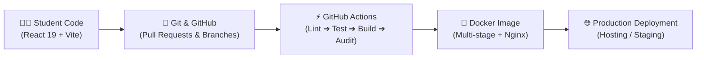

# DevOps Engineering Training Program 🚀
> **Foundations of Modern Continuous Integration, Continuous Delivery (CI/CD), and Cloud Native Engineering.**

Welcome to the foundational repository for the **DevOps Engineering Training Program**. This repository is specifically structured as an educational sandbox where students learn real-world DevOps practices by working with an actual frontend application, automated testing suites, multi-stage CI/CD pipelines, and containerization.

---

## 📑 Table of Contents
- [1. Repository Purpose & Architecture](#1-repository-purpose--architecture)
- [2. CI/CD Pipeline Breakdown (Student Perspective)](#2-cicd-pipeline-breakdown-student-perspective)
- [3. Codebase Overview (React Frontend)](#3-codebase-overview-react-frontend)
- [4. Quick Start Guide for Students](#4-quick-start-guide-for-students)
- [5. Containerization with Docker](#5-containerization-with-docker)
- [6. Hands-on Student Exercises](#6-hands-on-student-labs)
- [7. Documentation & Learning Resources](#7-documentation--learning-resources)

---

## 1. Repository Purpose & Architecture

In modern software development, code does not jump directly from a programmer's computer into production. It travels through an automated **software delivery supply chain**:



### Key Technical Stack
- **Frontend Framework:** React 19 + Vite (Fast compilation, ES modules)
- **Unit Testing Engine:** Vitest + React Testing Library (Automated assertion suite)
- **Code Quality / Linter:** Oxlint (Static code analysis)
- **CI/CD Platform:** GitHub Actions (Multi-job declarative workflow)
- **Container Runtime:** Docker Multi-stage (Node.js build stage ➔ Nginx Alpine runtime)
- **Local Orchestration:** Docker Compose

---

## 2. CI/CD Pipeline Breakdown (Student Perspective)

The main workflow is defined in [`.github/workflows/ci-cd.yml`](.github/workflows/ci-cd.yml).
Each stage is separated into an independent **job** so students can see exactly where failures occur.

```mermaid
graph TD
    subgraph CI_Pipeline ["GitHub Actions CI/CD Pipeline"]
        J1["Job 1: Code Quality & Lint\n(oxlint checks syntax & standards)"]
        J2["Job 2: Automated Unit Tests\n(vitest runs 6 test assertions)"]
        J3["Job 3: Build & Package\n(vite compiles dist/ & uploads artifact)"]
        J4["Job 4: DevSecOps Audit\n(npm audit checks for CVEs)"]
        J5["Job 5: Docker Container Check\n(builds Alpine image & healthcheck probe)"]
        J6["Job 6: Deploy to Hosting\n(publishes verified artifact to GitHub Pages)"]

        J1 -->|Success| J2
        J2 -->|Success| J3
        J2 -->|Success| J4
        J3 -->|Success| J5
        J3 & J4 & J5 -->|Success (main only)| J6
    end
```

### Why Each Job Exists:
| Job Name | What It Does | Why It Matters to DevOps |
| :--- | :--- | :--- |
| **`code-quality`** | Runs static analysis to catch formatting, syntax errors, and bad patterns. | **Fails Fast:** Stops broken code in seconds before wasting server time building. |
| **`unit-tests`** | Runs automated tests to verify logic correctness. | **Quality Gate:** Ensures bug-free functionality before deployment. |
| **`build-and-package`** | Compiles JSX/CSS into static bundle (`dist/`) and uploads as pipeline artifact. | **Build Once:** Downstream jobs deploy the exact verified bundle without re-compiling. |
| **`security-audit`** | Runs `npm audit` against the National Vulnerability Database. | **Shift Left:** Identifies third-party security vulnerabilities early. |
| **`docker-verification`** | Builds the multi-stage Dockerfile and validates the `/healthz` probe. | **Immutable Delivery:** Verifies the application container runs reliably on Linux. |
| **`deploy-staging`** | Deploys static build to GitHub Pages or staging server. | **Continuous Delivery:** Releases software automatically upon merging to `main`. |

---

## 3. Codebase Overview (React Frontend)

The application is located in the [`frontend/`](frontend/) directory. To keep students engaged and excited, the website is built as **GitHappens ☕** — a funny, lighthearted developer comedy and coffee club:
- **🎭 Developer Joke Stage:** Interactive joke card with hidden punchlines (*"Why do programmers prefer dark mode? Because light attracts bugs!"*) that students can click to reveal and cycle.
- **☕ Coffee-to-Code Meter:** Interactive counter tracking cups of coffee and dynamically changing developer mood from *"Zombie Mode"* to *"Talking directly to the CPU in binary"*.
- **🗳️ "Bug or Feature?" Community Poll:** Live voting on hilarious developer dilemmas (*"The code only runs on my localhost"*).
- **🚨 Friday Production Panic Button:** Big red button for accidental merges to `main` at 4:59 PM.
- **🎓 Zero-Jargon Codebase:** The code in `App.jsx` is intentionally straightforward with friendly comment hints so any student can add their own joke, push to Git, and watch GitHub Actions deploy their live update!

---

## 4. Quick Start Guide for Students

You can run commands from the repository root or inside the `frontend/` folder.

### 1. Prerequisites
- [Git](https://git-scm.com/) (v2.30+)
- [Node.js](https://nodejs.org/) (v20+ or v22+ LTS)
- [Docker Desktop](https://www.docker.com/products/docker-desktop/) (Optional for container lab)

### 2. Clone and Run Locally
```bash
# Clone the repository
git clone <your-repo-url>
cd DevOps_Program

# Run the development server
npm run dev
```
Open your browser and visit: `http://localhost:5173`

### 3. Run Automated Tests
```bash
# Run unit tests once (CI mode)
npm run test:run

# Run linter
npm run lint

# Compile production bundle
npm run build
```

---

## 5. Containerization with Docker

The application includes an optimized multi-stage `Dockerfile`:
- **Stage 1 (Node.js Alpine):** Compiles React source code into minified static assets.
- **Stage 2 (Nginx Alpine):** Discards Node.js and source files; serves static files using Nginx with HTTP compression and security headers (~25MB total image size).

### Run with Docker Compose
```bash
# Build and run containerized website
npm run docker:up

# Open in browser: http://localhost:8080

# Stop container
npm run docker:down
```

---

## 6. Hands-on Student Labs

To build real DevOps muscle memory, complete these hands-on lab exercises:

### 🧪 Lab 1: Customize Your Joke & Watch GitHub Actions Deploy It!
1. Open `frontend/src/App.jsx`.
2. Find the `DEV_JOKES` array at the top of the file.
3. Add your own funny joke or change the first joke's punchline.
4. Run `npm run test:run` locally to verify that unit tests pass.
5. Commit and push: `git commit -am "feat: add my custom joke" && git push`.
6. Open GitHub Actions in your browser: watch **Jobs 1 through 6** turn green, and open the live website to see your joke live on the internet!

### 🧪 Lab 2: Practice Pull Request Branch Protection
1. Create a feature branch: `git checkout -b feature/my-badge`.
2. Add a new banner or component in `frontend/src/`.
3. Push to GitHub and create a Pull Request into `main`.
4. Watch how the [`pr-check.yml`](.github/workflows/pr-check.yml) workflow automatically validates your PR before merge!

### 🧪 Lab 3: Build & Inspect Docker Image
1. Build the image: `docker build -t devops-portal:v1 ./frontend`.
2. Inspect the image size: `docker images devops-portal:v1`.
3. Run the container: `docker run -d -p 8080:80 devops-portal:v1`.
4. Test the healthcheck endpoint: `curl http://localhost:8080/healthz`.

---

## 7. Documentation & Learning Resources

Detailed curriculum materials are available in the [`docs/`](docs/) directory:
- 📐 [**HLS Architecture Document**](docs/HLS_ARCHITECTURE.md) - High-level system architecture, Mermaid sequence diagrams, and container architecture.
- 📖 [**Student Learning Guide**](docs/STUDENT_GUIDE.md) - Step-by-step setup, troubleshooting, and lab walkthroughs.
- 🗺️ [**Course Roadmap**](docs/ROADMAP.md) - Progression through Git, CI/CD, Docker, Kubernetes, Terraform, and SRE.

---

## 📂 Repository Directory Tree

```text
DevOps_Program/
├── .github/
│   └── workflows/
│       ├── ci-cd.yml             # Full 6-job CI/CD Pipeline
│       └── pr-check.yml          # Pull Request status check gate
├── docs/
│   ├── HLS_ARCHITECTURE.md       # High-Level Architecture documentation
│   ├── STUDENT_GUIDE.md          # Comprehensive student lab guide
│   └── ROADMAP.md                # Curriculum module roadmap
├── frontend/
│   ├── src/
│   │   ├── App.css               # Modern responsive styling
│   │   ├── App.jsx               # Interactive student portal & simulator
│   │   ├── App.test.jsx          # Vitest automated unit test suite
│   │   ├── index.css             # Base CSS variables & resets
│   │   ├── main.jsx              # React 19 entrypoint
│   │   └── setupTests.js         # Vitest DOM assertions configuration
│   ├── Dockerfile                # Multi-stage production container build
│   ├── nginx.conf                # Nginx web server config & SPA routing
│   ├── package.json              # Frontend dependencies and scripts
│   └── vite.config.js            # Vite configuration with Vitest setup
├── docker-compose.yml            # Local one-click container orchestrator
├── package.json                  # Root convenience scripts for students
├── .gitignore                    # Git ignore file for dependencies and artifacts
└── README.md                     # Main Course & Repo Hub
```
