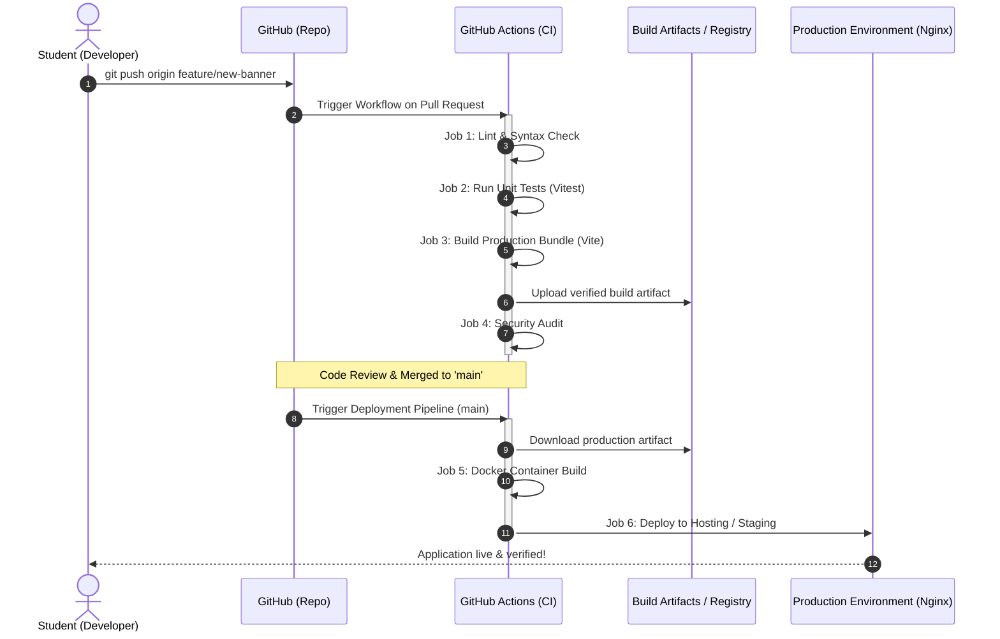
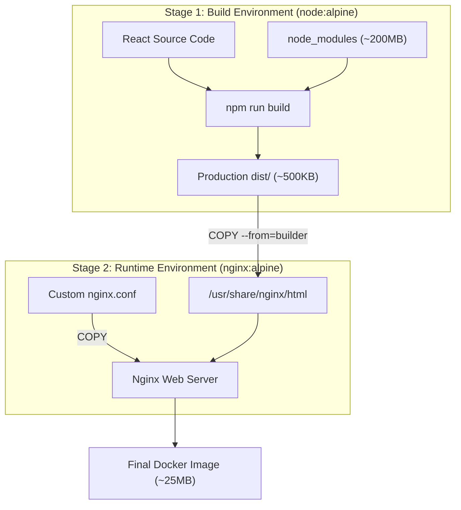

# High-Level System & Solution Architecture (HLS)
## DevOps Engineering Training Program

This document provides a high-level overview of the end-to-end system architecture, source control workflow, CI/CD pipeline lifecycle, and containerized deployment model designed for the DevOps Engineering Program.

---

## 1. System Overview

The primary objective of this architecture is to provide students with a clear, production-grade DevOps workflow starting from a single modern frontend service (React) and scaling to multi-service, multi-cloud architectures.

```mermaid
flowchart LR
    subgraph Developer_Workstation["1. Developer Machine"]
        Dev["Student / Engineer"]
        LocalGit["Local Git Repository"]
        DevServer["Local Vite Server / Docker"]
        Dev -->|Code & Test| DevServer
        Dev -->|Commit & Push| LocalGit
    end

    subgraph GitHub_VCS["2. Source Control & Governance"]
        RemoteRepo["GitHub Repository (DevOps_Program)"]
        PR["Pull Request / Branch Protection"]
        LocalGit -->|Push to feature/main| RemoteRepo
        RemoteRepo -->|Trigger| PR
    end

    subgraph CICD_Pipeline["3. GitHub Actions CI/CD Pipeline"]
        Job1["1. Code Quality & Lint"]
        Job2["2. Automated Unit Tests"]
        Job3["3. Production Build & Bundle"]
        Job4["4. DevSecOps & Dependency Audit"]
        Job5["5. Containerization / Docker Image"]
        Job6["6. Staging / Production Deployment"]

        Job1 --> Job2 --> Job3 --> Job4 --> Job5 --> Job6
    end

    subgraph Runtime_Environments["4. Target AWS Infrastructure"]
        ECR["AWS ECR Private Registry\n322473970206.dkr.ecr.ap-southeast-2.amazonaws.com\n/devops_program_cc_fe"]
        EC2["AWS EC2 Production Server\nUbuntu 24.04 (13.210.209.34)\nPort 80 (Nginx Alpine Container)"]
        Job6 -->|1. Push Docker Image| ECR
        ECR -->|2. Pull & Run| EC2
    end

    PR --> CICD_Pipeline
```

---

## 2. Core Architectural Components

### A. Codebase Layer
- **Framework:** React 19 + Vite (Fast compilation, ES Modules, lightweight footprint).
- **Testing Engine:** Vitest + React Testing Library (Fast unit & component testing).
- **Code Quality:** Oxlint / ESLint (Static syntax, style, and potential bug detection).
- **Web Server:** Nginx Alpine (Lightweight, high-performance static file server with gzip compression and caching).

### B. CI/CD Pipeline Layer (GitHub Actions)
The pipeline is segmented into distinct, isolated jobs so students can visualize each phase of the DevOps delivery pipeline:

| Job Name | Responsibility | Educational Objective |
| :--- | :--- | :--- |
| **1. Code Quality** | Lints code, checks formatting & syntax rules | Understand static code analysis before wasting build time |
| **2. Automated Tests** | Executes Vitest unit tests & exports test reports | Understand test automation as a quality gate |
| **3. Build & Package** | Compiles production assets into `dist/` | Understand artifact creation & minification |
| **4. Security Audit** | Runs `npm audit` for known CVE vulnerabilities | Learn DevSecOps principles (shifting security left) |
| **5. Container Packaging** | Builds Docker image using multi-stage Dockerfile | Understand immutable container packaging |
| **6. Deployment** | Authenticates with AWS ECR, pushes image, and launches container on EC2 (`13.210.209.34`) | Understand production CD, container registries (ECR), and cloud server automation |

---

## 3. High-Level Delivery Flow (GitOps Workflow)

---

## 4. Multi-Stage Containerization Architecture

To teach industry best practices, the React application uses a **Multi-Stage Dockerfile**:

### Why Multi-Stage?
1. **Security:** Node.js, npm, package managers, and source code are NOT included in the final production image.
2. **Size Optimization:** Reduces image size from ~500MB+ down to ~25MB.
3. **Attack Surface Reduction:** Minimal Alpine Linux image with only Nginx running.

---

## 5. Progression & Future Roadmap

As students advance through the course, this base repository will be augmented with:
- **Module 2:** Backend REST API integration (Node.js Express / Python FastAPI).
- **Module 3:** Container orchestration using Kubernetes (Deployments, Services, Ingress, ConfigMaps).
- **Module 4:** Infrastructure as Code (IaC) using Terraform / AWS / GCP / Azure.
- **Module 5:** Observability & Monitoring (Prometheus, Grafana, Loki / CloudWatch).
