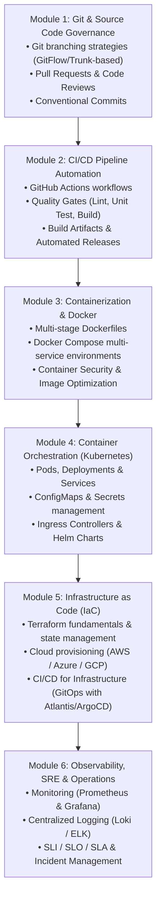

# DevOps Engineering Program: Course Roadmap

This roadmap outlines the complete learning progression for students in the DevOps Engineering Program, starting from foundational source control to enterprise-scale Kubernetes and Cloud Infrastructure.

---

## 🗺️ Progression Path

---

## Detailed Curriculum Breakdown

### 📍 Phase 1: Foundations (Current Repository Scope)
- **Status:** Active / Ready
- **Key Concepts:**
  - React Single Page App architecture
  - Static Code Analysis (Oxlint/ESLint)
  - Automated Unit Testing (Vitest + Testing Library)
  - GitHub Actions Multi-stage Pipeline
  - Docker multi-stage build & Nginx deployment

### 📍 Phase 2: Backend Integration & Multi-Service CI/CD
- **Status:** Planned
- **Upcoming Deliverables:**
  - Add `backend/` microservice (Node.js Express / Python FastAPI)
  - Automated API tests (Supertest / Pytest)
  - Docker Compose orchestrating frontend + backend + database

### 📍 Phase 3: Cloud & GitOps Deployment
- **Status:** Planned
- **Upcoming Deliverables:**
  - Kubernetes manifests (`k8s/deployment.yaml`, `k8s/service.yaml`)
  - Automated deployment to local Minikube / K3s / Cloud EKS/GKE
  - ArgoCD GitOps Continuous Delivery integration
