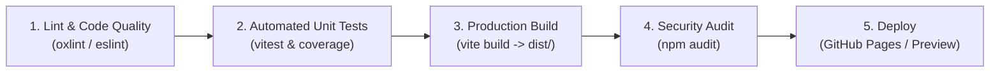

# Student Learning Guide: DevOps CI/CD Fundamentals

Welcome to the **DevOps Engineering Training Program**! This repository serves as your practical, hands-on laboratory where you will learn how modern software is built, tested, packaged, and deployed automatically using industry-standard tools.

---

## 📋 Table of Contents
1. [Prerequisites & Setup](#1-prerequisites--setup)
2. [Project Structure Explained](#2-project-structure-explained)
3. [Running the Application Locally](#3-running-the-application-locally)
4. [Running Tests Locally](#4-running-tests-locally)
5. [Understanding the CI/CD Pipeline](#5-understanding-the-cicd-pipeline)
6. [Hands-On Student Labs & Exercises](#6-hands-on-student-labs--exercises)
7. [Troubleshooting CI/CD Failures](#7-troubleshooting-cicd-failures)

---

## 1. Prerequisites & Setup

Before starting, ensure your developer workstation has the following installed:
- **Git:** `git --version` (v2.30+)
- **Node.js:** `node -v` (v20+ or v22+ LTS recommended)
- **Docker Desktop:** `docker --version` (Optional for Lab 3, required for containerization)
- **Code Editor:** VS Code / Cursor recommended

### Clone the Repository
```bash
git clone <your-repository-url>
cd DevOps_Program
```

---

## 2. Project Structure Explained

```text
DevOps_Program/
├── .github/
│   └── workflows/
│       ├── ci-cd.yml           <-- The master CI/CD workflow (Lint -> Test -> Build -> Security -> Deploy)
│       └── pr-check.yml        <-- Fast Pull Request verification gate
├── docs/
│   ├── HLS_ARCHITECTURE.md     <-- High Level Solution and pipeline architecture diagrams
│   ├── STUDENT_GUIDE.md        <-- This guide
│   └── ROADMAP.md              <-- Full DevOps curriculum roadmap
├── frontend/                   <-- The React website application
│   ├── src/
│   │   ├── components/         <-- Reusable UI components
│   │   ├── App.jsx             <-- Main dashboard page
│   │   ├── App.test.jsx        <-- Automated unit test suite
│   │   └── main.jsx            <-- Application entrypoint
│   ├── Dockerfile              <-- Multi-stage production container build
│   ├── nginx.conf              <-- Production static web server configuration
│   └── package.json            <-- NPM dependencies and test/build scripts
├── docker-compose.yml          <-- Run the entire containerized app locally with 1 command
└── README.md                   <-- Main landing documentation
```

---

## 3. Running the Application Locally

Navigate to the `frontend` folder:
```bash
cd frontend
npm install
npm run dev
```
Open your browser and navigate to `http://localhost:5173`. You will see the **GitHappens ☕** web app live!

---

## 4. Running Tests Locally

DevOps engineers test code *locally* before pushing to remote repositories.

```bash
cd frontend

# 1. Run static code linter
npm run lint

# 2. Run unit tests in watch mode
npm run test

# 3. Run unit tests once with coverage report
npm run test:run
```

---

## 5. Understanding the CI/CD Pipeline

The GitHub Actions workflow is located at `.github/workflows/ci-cd.yml`.
When you push code or open a pull request, GitHub automatically triggers 5 sequential stages:



### Why are jobs separated?
- **Fail Fast:** If the linter or tests fail, the pipeline immediately stops. This saves compute time and prevents broken code from ever being built or deployed.
- **Traceability:** When a job turns red, you know immediately whether it was a formatting bug, a logic error in unit tests, or a build failure.
- **Artifact Passing:** The `build` job uploads the production `dist/` directory as a pipeline artifact, which the `deploy` job downloads and publishes.

---

## 6. Hands-On Student Labs & Exercises

### 🧪 Lab 1: Add Your Own Joke & Watch GitHub Actions Deploy It
1. Open `frontend/src/App.jsx`.
2. Look at the `DEV_JOKES` array at the top.
3. Add a new joke object or customize one of the punchlines.
4. Run `npm run test:run` locally.
5. Commit and push your change: `git commit -am "feat: add student joke" && git push`.
6. Watch GitHub Actions test, build, and deploy your joke live to the web!

### 🧪 Lab 2: Add Your First DevOps Feature
1. Create a new branch: `git checkout -b feature/student-profile`.
2. Add a new component in `frontend/src/components/StudentBadge.jsx` that displays your name and student ID.
3. Write a unit test in `frontend/src/components/StudentBadge.test.jsx`.
4. Run `npm test:run` to verify it passes.
5. Push to GitHub and create a Pull Request. Watch the automated PR check validate your code.

### 🧪 Lab 3: Containerize with Docker
1. Ensure Docker Desktop is running.
2. Build the Docker container locally:
   ```bash
   docker build -t devops-portal:v1 ./frontend
   ```
3. Run the container:
   ```bash
   docker run -p 8080:80 devops-portal:v1
   ```
4. Open `http://localhost:8080` in your browser. You are now running your React app served directly from **Nginx inside an Alpine Linux container**!

---

## 7. Troubleshooting CI/CD Failures

| Error Message in GitHub Actions | Likely Root Cause | How to Fix |
| :--- | :--- | :--- |
| `Process completed with exit code 1 in lint` | Syntax error or unused variable | Run `npm run lint` locally and fix warnings |
| `FAIL App.test.jsx` | Component output does not match expected test assertion | Run `npm run test` locally and verify assertions |
| `npm audit report: High vulnerabilities found` | Outdated or insecure package | Run `npm audit fix` in `frontend/` |
| `Build failed: cannot find module` | Missing dependency in `package.json` | Ensure all packages are saved with `npm install <pkg>` |
